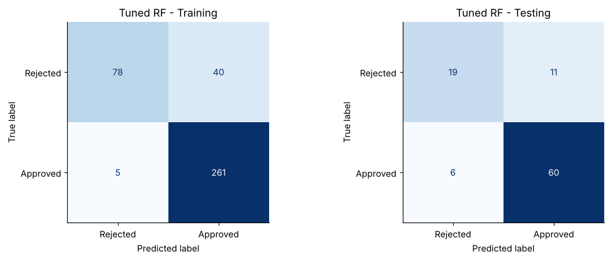
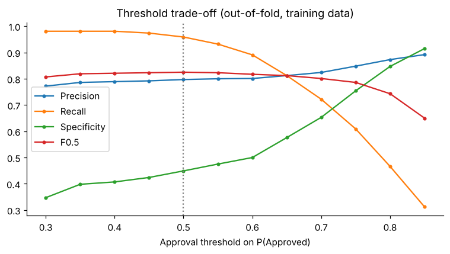
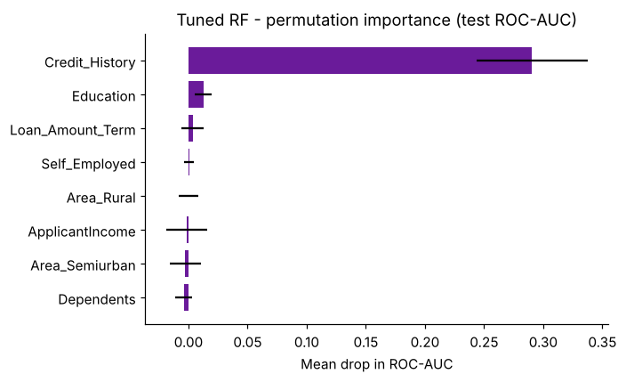

# Loan Approval Prediction with Random Forest

Predicting loan approval from applicant, income, credit, loan and property attributes. A baseline Random Forest is compared with a tuned one, and both are benchmarked against a one-line credit-history rule.

  

## Key results

| Model (test set, n = 96) | Accuracy | Precision | Recall | Specificity | F0.5 | ROC-AUC |
|---|---|---|---|---|---|---|
| Credit-history rule | 0.833 | 0.821 | 0.970 | 0.533 | 0.847 | 0.752 |
| Baseline Random Forest | 0.792 | 0.838 | 0.864 | 0.633 | 0.843 | 0.801 |
| **Tuned Random Forest** | 0.823 | 0.845 | 0.909 | 0.633 | **0.857** | 0.795 |

Repeated stratified CV (5 folds x 10 repeats) on the full dataset:

| Metric | Baseline RF | Tuned RF | Credit-history rule |
|---|---|---|---|
| F0.5 | 0.823 ± 0.027 | 0.827 ± 0.028 | 0.825 ± 0.025 |
| Accuracy | 0.788 ± 0.037 | 0.804 ± 0.035 | 0.808 ± 0.032 |
| ROC-AUC | 0.759 ± 0.064 | 0.764 ± 0.058 | 0.702 ± 0.049 |

**Findings**

1. Tuning cut the F0.5 train-test gap from 0.157 to 0.031. The only hyperparameter that changed from the defaults was `min_samples_split = 10`.
2. On F0.5, F1 and accuracy the tuned forest is statistically tied with the rule *approve if `Credit_History == 1`*.
3. The forest's measurable advantage is ranking (ROC-AUC +0.06 over the rule). That lets a lender set the approval threshold to a chosen risk appetite.
4. Permutation importance on the test set shows Credit_History as the only feature with a measurable effect. Impurity importance ranked income and loan amount 2nd and 3rd, which is the known bias of impurity importance towards continuous features.

## Why F0.5?

Approving an application that should have been rejected (a false positive) usually costs a lender more than declining a good one. F0.5 weights precision twice as heavily as recall. Unlike precision alone, it still penalises a model that rejects everyone. It is used as the scoring metric in `GridSearchCV`. Accuracy, precision, recall, specificity, F1 and ROC-AUC are reported alongside it.

## Approach

1. Stratified 80/20 split (384 train / 96 test). Encoding is fitted on the training data only.
2. Baseline `RandomForestClassifier` with default hyperparameters.
3. `GridSearchCV`: 144 combinations of `n_estimators`, `max_depth`, `min_samples_split`, `min_samples_leaf` and `class_weight`, using stratified 5-fold CV and F0.5 scoring.
4. Test-set evaluation: confusion matrices, ROC curves, and a baseline vs tuned comparison.
5. Extensions beyond the exercise:
   - one-rule benchmark
   - repeated-CV stability check
   - decision-threshold trade-off on out-of-fold training probabilities
   - permutation importance on the test set

<p align="center">
  <br>
   
</p>

## Repository structure

```
loan-approval-random-forest/
├── data/
│   └── Loan_Prediction_data.csv          # 480 applications, 11 features + target
├── starter/
│   └── Random Forest Classifier Exercise.ipynb   # original exercise template (unchanged)
├── notebooks/
│   └── loan_approval_random_forest.ipynb # completed analysis, executed with outputs
├── outputs/
│   ├── figures/                          # all plots generated by the notebook
│   └── metrics/                          # CSV tables generated by the notebook
├── reports/
│   └── Loan_Approval_Random_Forest_Report.docx
├── requirements.txt
├── LICENSE
└── README.md
```

## How to run

```bash
git clone https://github.com/kashiprasadtn/loan-approval-random-forest.git
cd loan-approval-random-forest
python -m venv .venv && source .venv/bin/activate   # Windows: .venv\Scripts\activate
pip install -r requirements.txt
jupyter lab notebooks/loan_approval_random_forest.ipynb
```

Run all cells. Every figure and metrics file in `outputs/` is regenerated (about 2 minutes on a laptop). `random_state = 42` is set throughout.

## Limitations

- Small sample: 96 test rows, of which 30 are rejections. One misclassification moves accuracy by about 1 percentage point.
- The data appears to be a complete-case subset of the public 614-row dataset, which may introduce selection bias.
- Gender and marital status are model inputs. A production lending model would need a fair-lending review before using them.
- Probabilities are not calibrated, and there is no external or time-based validation.

## Data and attribution

- **Dataset:** a 480-row version of the *Loan Prediction* practice dataset (Dream Housing Finance), originally published by Analytics Vidhya and supplied here through upGrad coursework. It is included for educational, non-commercial use and remains the property of its original publisher.
- **Starter notebook:** the exercise template in `starter/` is upGrad course material, kept unchanged for reference. The analysis in `notebooks/` is my own implementation.
- Coursework completed during my MS in Artificial Intelligence (Liverpool John Moores University, delivered via upGrad); published to GitHub in November 2026.

## Licence

Code is released under the [MIT License](LICENSE). The dataset and starter notebook are excluded (see above).
